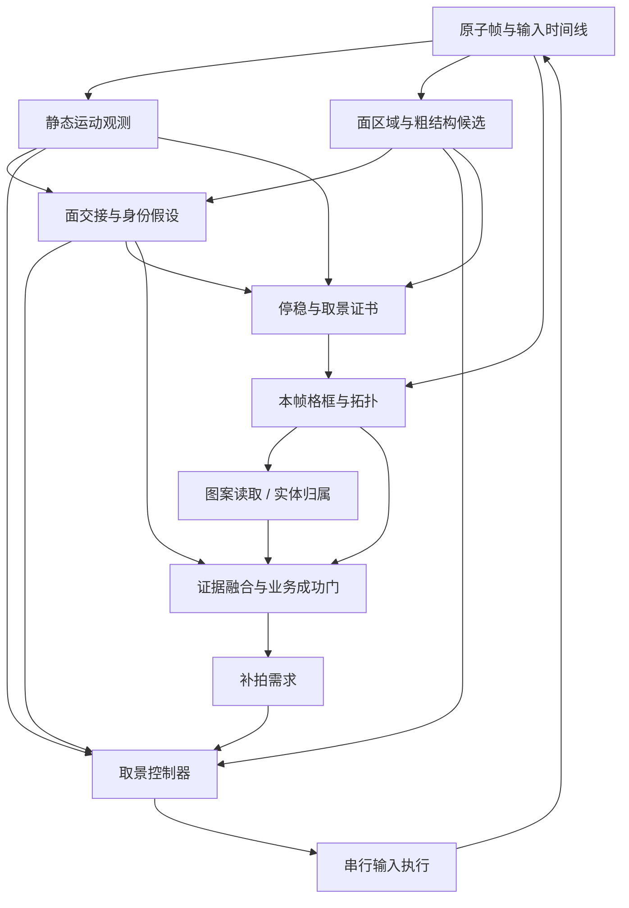

# 深潜四视角取景与识别重设计

2026-10-22 后续：识别路线以[基于客户端模型与坐标链的重设计](resonance-pc-deep-dive-native-recognition-design.md)为准。后续稿结合本轮实机和当前客户端字节码、配置及预制体核验，优先替换识别，暂缓拖动自适应。本文保留此前设计背景，不能将其中尚未验证的几何假设视作当前事实。

日期：2026-10-22。状态：设计评审稿，供后续实现评审；本轮未改运行代码、资产或阈值，未运行测试、算法重放或实机操作。

Astra已只读审阅初稿，认为分层方向可作为设计与素材采集依据；本稿纳入其单轴可达性、计数闭合前提、新鲜采样与标定顺序四项意见。生产实现和稳定性仍未获素材验证。

## 1. 目标、范围与当前结论

保留“四个便于阅读的取景区域覆盖六面”的目标，将实现拆成三个可分别验证的核心问题：

1. 相机实际怎样运动，是否响应输入、是否已经停稳。
2. 当前看见的是哪些面，格子在本次扫描坐标系中的身份是什么。
3. 本帧图案板边界在哪里，里面是什么，浮空目标属于哪格。

首选路线是：**连续图像运动用于控制，连续面交接维护身份，停稳后直接定位本帧格框，再读语义与实体。** 不要求先恢复精确3D相机或训练新模型。每层保留失败和歧义，禁止把一份局部模板拟合的低残差同时解释成相机到位、面身份正确和九格定位正确。

“四个视角”是四类可读姿态区域，不是四个必须精确命中的物理角度，也不是总共只能拍四组图。必要的补充取景由尚未消除的歧义决定。各标准姿态应满足什么可见性，需在完整取景素材上确定。

本设计不涉及移动规划、事件执行、全流程与规划流程的接线、GUI功能扩展。继续遵循 workflow → 用户任务 → 业务操作 → 共享能力；新视觉状态不成为跨任务隐式接口。

## 2. 证据与适用边界

设计依据：

- Astra独立评审：`.pytest_tmp/four-view-astra-review-20261022/review.md`。
- 唯一实机扫描：`logs/deep_dive_scan/20261022-152234-b22b0106/`；20.625秒、6次拖动、10张图，在首视角报 `four_view_1_local_feedback_lost`；没有完成标准视角。
- 已冻结离线取证：`.pytest_tmp/four-view-forensics-20261022/analysis.md` 及其 `right-lines/`、`candidates/`。
- 当前实现：`plans/resonance_pc/src/actions/_deep_dive_four_view_{scan,geometry,epoch_registration,reader,targets,layout,candidate_closure}.py`，以及 `_deep_dive_target_readiness.py`。

已知：单段资格门、对应选择和结构硬门能解释保存帧上的输出变化；同一线段能贡献多个anchor票；当前停稳只检查到位区间；面身份依赖reset和扫描顺序。frame 8有结构通过但格位置不理想的支路，最终中心门拒绝了它，不能称为已经错误控制。

尚未知：真实板框、完整跨面轨迹、reset与规范坐标的可重复关系、局部输入响应、惯性范围、四姿态通用性。旧资产预期边和自动亮中心不是人工真值；不能据现有10张稀疏图断言碎段聚合就能修复四视角。

因此，目前可以确定职责与数据契约；不能冻结运动观测量、停稳阈值、姿态模板和自动恢复策略，更不能据此替换生产路线。

## 3. 层次与依赖方向

实体检测可以先用于排除浮空区域；该用途不依赖实体归属正确。检测没有覆盖的动态区域仍由运动一致性检查剔除，不能将检测框之外全部当静态。

| 层 | 负责输出 | 不承担的证明 | 失败后行为 |
| --- | --- | --- | --- |
| 帧与输入 | 同源原子图像、采集/输入时间、版本和epoch | 图像内容正确、输入必然生效 | 过期或混源帧不得驱动输入 |
| 运动观测 | 分区域位移、覆盖、误差界、响应与停稳状态 | 规范面名、图案类别 | `moving / settled / unobservable`分别输出 |
| 面身份 | 匿名面轨迹、邻接、规范映射候选及来源 | 格子语义、精确相机角 | 多解保留；失链后禁止拼接规范坐标 |
| 取景控制 | 朝可读姿态区域的受限输入及停止条件 | “分类成功所以到位” | 不确定时先松手，恢复观测或退出 |
| 格框几何 | 本帧板框、行列邻接、可见性和定位误差 | 面名绝对正确、warp后类别正确 | 缺格、歧义或传播格输出unknown |
| 内容与实体 | 给定可靠格框的类别；实体候选及归属 | 分类结果认证格框；没检测到就空 | 冲突与遮挡保留unknown |
| 融合与成功门 | 证据闭合、目标列表或完整布局 | 时间戳/组号等于独立证据 | 返回partial及下一项观测需求 |

共享原图不等于各层统计独立。本设计追求的是职责可拆、来源可追溯、错误不被反向认证；所有使用同一特征、模板或身份链的结果须登记共同依赖。

## 4. 数据契约与生命周期

以下为拟议内部记录，不在本轮创建代码或修改现有schema。

| 记录 | 必要字段与含义 |
| --- | --- |
| `FramePacket` | capture session/generation、frame id、source采集时间、处理完成时间、原尺寸/坐标变换、图像路径/hash、board epoch、配置与模型版本 |
| `InputEvent` | 输入id、down/move/up时间、命令位移、实际执行结果、决策引用的frame id；命令位移不充当相机位移 |
| `MotionObservation` | 起止frame、各区域匹配点/位移分布、覆盖、前后向误差、失跟比例、遮罩、运动上界、可观测状态；保留原始支持 |
| `FaceHypotheses` | 匿名面id、持续特征、面交接边、行列方向候选、规范映射候选集、最近唯一锚点、identity-chain id与歧义原因 |
| `PoseDescriptor` | 可见面组合、粗轴方向/宽度比/压缩程度等图像量、误差界及参考版本；不命名为物理pitch |
| `ViewCertificate` | 身份链、取景区域、停稳窗口、姿态质量、可读区域、引用帧、每项门状态与原因；不存在单个“万能置信度” |
| `CellGeometry` | anonymous face/row/col及规范映射引用、四角及误差范围、直接观测/传播标记、边/角支持id、遮挡/裁切、模型和留出检查 |
| `CellReading` | 格框id、裁剪变换、原始类别分数、拒绝原因、最终类别或unknown；不沿用格框分数作语义分数 |
| `EntityObservation` | 检测框/原始分数、可见接触或锚点、候选格集合、多视轨迹、关联歧义、遮挡与检测运行状态 |
| `EvidenceBundle` | 上述记录引用、correlation family、冲突、实际几何基线、可见性、结果状态和适用业务目标 |

内部状态统一使用 `valid / ambiguous / unobservable / stale / conflict` 等有原因的枚举；模型原始分数与经验质量量分开，未校准的质量分不得称为正确概率。

生命周期必须区分：

- `board_epoch`：棋盘内容/玩家状态所属轮次。进入新盘、移动/事件造成状态变化、无法判明的盘面变化均使旧业务证据失效。
- `identity_chain_id`：连续面身份链。相机reset或不可恢复失跟结束旧链；只有可审核的唯一映射才能把链间数据合并。
- `map_revision`：同一盘已确认的坐标/拓扑版本。重编号不得静默覆盖已有结果。
- `pose_reference_id`：经审核的取景参考与适用范围。不能自动把第一次“看似到位”封成真值零点。

这些是新内部概念，不取代现有 `plane_epoch / scan_epoch / map_revision / view_epoch`。适配器须保留原版本绑定：位面切换失效全部旧盘信息；新scan不能复用旧动作；进入操作模式需要新的view与参考。即使几何仍匹配，玩家/敌方行动后的目标和路径证据也不得继续有效。

capture重启、尺寸变化、画面切换、取消或预算耗尽均中止当前控制。身份重建失败时保留旧记录作诊断，但不继续作为当前行动依据。

## 5. 相机观测与取景控制

### 5.1 先建立运动观测，不以九格分类作为启动条件

在立方体区域提取并跟踪静态局部特征。首选稀疏跟踪加关键帧描述子重识别；前后向一致性、分区域覆盖及鲁棒运动共识共同筛选。HUD和浮空目标区域排除；闪烁、旋转图案和特效通过与相邻结构运动不一致被降权或拒绝。

立方体不是单一平面：按可见面/局部区域描述运动，不要求全物体服从同一个单应性。初期粗区域可没有规范面名，也不需要格类别。若只剩一处纹理、各区域响应矛盾或结构支撑不足，输出unobservable，不能用零匹配当零运动。

停稳由**松手后的连续时间窗口**定义：覆盖充分的各可靠区域运动上界均低于容差，窗口内无输入，图像来源连续且延迟有效。禁止重复消费同一capture样本或给旧图重新打时间戳增加支持；真正新鲜采样即使像素/hash完全相同，也可以贡献时间证据。覆盖来自此前已建立且仍有效的跟踪，不能因图像相同自行增加空间支持。记录运动分布和不确定度，不只记录均值；一小块静止不能掩盖另一面仍在动。

采集、输入和分析年龄统一使用单调时钟，位移结合实际采样间隔解释。当前原子WGC以session、递增generation及采集时间区分新样本；必须核实静止画面下的后端语义。若不产生可证明的新采样，输出观测不足，不能等待超时后自动判停稳。

窗口时长、位移/速度容差、允许间隔和空间覆盖门必须由后续带时间素材标定。本轮不延用“.35秒后即停稳”或“三帧在误差区间即停稳”。

### 5.2 可控误差与可读姿态

目标采用经独立审核的**可读图像形状区域**，而非旧参考的单一倾斜差。候选描述量包括可见面轴方向、两面宽度比、板框压缩程度、边缘截断和投影格尺寸。控制层使用粗面/板结构，不消费图案类别、分类置信度或已读格数。

目标参考至少包含身份、允许变化范围、可读性与适用分辨率。标准参考可以是多张不同盘面上确认的形状状态；旧资产仅作候选初始化。哪些描述量对输入具有局部稳定响应，必须先由素材证明，不能现在拍定一个组合权重。

当前首选仍是垂直拖动这一输入自由度。多维形状描述不代表拥有多轴控制能力：四类目标区域必须与实测单轴扫描轨迹相交；局部响应只控制该输入可驱动的误差分量，宽度比、偏轴、裁切等其余量可以只是约束/拒绝门。不可达或偏轴时停止或reset，不无限修正。若素材证明目标不在同一受控轨迹上，须重新设计输入自由度并单独评审，不在现有单轴控制器内掩盖。

局部响应以实际输入和随后运动观测估计。只有变化大于观测不确定度、响应方向一致、落在已证实的局部范围内才继续修正。步长由剩余图像误差、响应范围和最大允许图像运动共同约束；不将命令像素换算成未经验证的真实角度。

### 5.3 控制状态机

| 状态 | 输入依据与动作 | 转移/拒绝条件 |
| --- | --- | --- |
| `bootstrap` | 确认画面、reset结果、建立静态轨迹和身份锚点 | 无唯一规范映射可以继续匿名观测，但不得宣告规范视角完成 |
| `search` | 连续可观测时做受限探步，检查实际响应与面交接 | 每步都需新鲜观测；失跟即停止，不连续盲推 |
| `approach` | 捕获区内根据已验证局部响应接近可读区域 | 反向/过大/不显著响应撤销响应模型，退回观测 |
| `release_observe` | 松手，连续采集；观测惯性/回弹 | 仍在动只观察；超时返回未停稳 |
| `certify` | 身份唯一、图像形状可读、实测停稳同时成立 | 生成证书后才提交读取；任一失败不建正式参考 |
| `reacquire` | 与已确认关键帧唯一重匹配，检查邻接一致性 | 无唯一续接则结束身份链；受限reset重采或退出 |
| `complete / partial` | 交给成功门或输出未解决原因 | 取消/预算结束始终先释放输入 |

仅允许一个输入执行者。分析旧帧期间不排队多次拖动；每条输入必须引用当前有效观测。采集线程与慢分类分离，分类不得阻塞停稳观测；处理延迟、丢帧和反馈年龄本身也是控制拒绝条件。

粗搜索期间观测不足时不得先执行一大段盲拖再补身份。允许重reset次数、输入总量、总时间均有预算；具体预算与步长待响应素材确定。输入方向异常、尺寸变化或目标消失，先松手再记录失败。

## 6. 面身份与坐标系

先跟踪匿名面和格，再讨论规范F/R/D/L/B/U。完全对称外观失去历史后不存在单帧唯一恢复面名的保证，算法必须承认这一点。

bootstrap必须核实reset契约：reset是否确实完成、玩家所在面与U的关系、初始可见面如何确定左右及行列轴。现有 `four_views_reset_player_up_v1` 声明不能作为该关系成立的独立证明。

若游戏只提供整体旋转等价的盘面，可以建立本次扫描的局部坐标规范，但必须证明该规范与规划器、点击/定向行动使用的规范一致。无锚点时保留旋转映射候选，不能为方便固定取第一个。玩家、图案描述子可帮助破除对称，但须记录对实体/内容识别的依赖；重复图案不是唯一锚点。

面交接以持续可见结构、旧面退出和新面进入方向、邻接以及格行列连续性来传播。拖动方向仅为先验。短时失跟必须与已确认关键帧取得空间分布充分且唯一的对应，且交接图无矛盾，才能续接；不能仅凭总拖动距离补齐经过的面。

以下必须保留unknown：reset未确认、跨面过程断裂且有多个续接、重复/对称内容无法区分、图像响应方向冲突、盘面变化与相机运动无法区分。失链后的新观测不得沿用旧规范格号；恢复失败时重新reset并重采当前需要的证据。

“完成四视角”要求四类姿态的**已证实面覆盖**，不能仅要求编号集合为1/2/3/4。view2/view4外观相似时，连续身份链必须提供区别；重复拍同一面不补足六面覆盖。

## 7. 本帧格框与拓扑

### 7.1 首选可实施路线

1. 在当前立方体区域提边缘、角点、有限线段、局部四边形。保留原始像素支持和候选替代项。碎段聚合仅生成候选，限制间隙/共线性/局部区域，不生成额外独立票。
2. 用板内外边缘关系、局部四角、相对两边方向、尺寸和时间连续性找图案板。显式保留“图案板/侧壁/内部纹理无法区分”的情况；亮中心可作内部提示，不能独自定义板框。
3. 将板框候选组成每面3×3邻接图，检查行列顺序、间隔、尺度变化、重复占位、遮挡和与相邻面方向的相容性。允许缺格，不为凑九格填入侧壁。
4. 以分布充分的直接观测约束每面模型。单应性作为待确认的平面模型；厚度、侧壁不计入同一平面。若留出边/角或新时间观测不符，拒绝整面传播或缩小至可靠局部格。
5. 输出每格四角及不确定度、直接/传播来源、身份链、遮挡与可读性。仅可靠且可见的区域交给分类器。

板框定位和控制的粗结构提取可复用底层候选，但结果契约不同：控制只需要有界局部形状和运动；读取需要每格四角/编号可靠。粗结构通过不自动使全部格框有效。

### 7.2 关联约束与拒绝门

观测边id与候选板边关联必须可审计。同一物理边可合法服务邻接板，但在全局支持中只算一个观测簇，不能当多个独立anchor。多个候选竞争同一纹理时保留联合假设，避免各自贪心选线再拼成“满秩”解。

拒绝门包括：候选多解无可靠区分、支持集中一角、重复格/行列交叉、邻接关系矛盾、留出边与投影模型不符、跨帧格号跳变、遮挡下仅靠模型补框。矩阵可逆、warp可执行、恰好九格、拟合残差低均不单独构成正确性证明。

传播框可以用于下一帧搜索和提出补拍需求；不能伪装成直接可见板框或负观测。留出检查用于发现过拟合/模型偏差，不声称它与拟合数据完全统计独立。

如果传统候选生成在不同盘面上无法覆盖可靠板边，先输出素材缺口与失败类型，再评估专用板框模型或人工标定资产；目前没有充分证据决定训练模型或购买新的推理成本。

## 8. 图案、实体与多视融合

图案读取继续复用现有warp与分类器作为候选能力，但前置可靠格框和可读区域。几何、类别、实体归属分别保存状态与分数。普通节点unknown不能拉低已确认实体的几何身份，也不能因节点分类高分提高实体归属分。

同姿态多帧用于检查动画和重复读数，不称为多个独立视角；保留冲突拒绝。补充姿态按未解决项选择，例如浮空目标跨格歧义、遮挡、某格过度压缩。每次补拍都需新的停稳证书。

姿态差异用有对应的板结构实际运动、视角形状变化及其不确定度描述；检验补拍之间也确实不同。不能用组号、新时间戳、发过命令或不同拟合误差值代替实际基线。具有共同模板、身份链或轨迹错误的观测记录为同一相关来源，不按组数换算正确概率。

实体检测输出与格归属分开：可见接触/脚部等直接线索优先；浮空且跨格的实体保留候选集，用真实多视轨迹相对板框的变化消歧。近似3D/FOV模型只产生候选，不建立新观测，不用拟合自身输入的低残差认证归属。

空占用需要逐格可见性和相应场景下检测能力的依据。`max_det`未满只表示推理未因数量上限截断，不是没有漏检。遮挡、特效覆盖、目标可能投影到别格或未建立该工况的漏检边界时，未检测到只能是unknown。禁止连续重复漏检被组数累积成“空”。

若第一阶段无法证明可靠负观测，targets只能使用有明确前提的计数闭合：HUD数值属于当前board epoch、语义确实约束全部剩余相关灵感实体、计数读取有效；每个已确认目标类别与归属通过正证据门，实体身份互异且未重复计数；确认数量恰好达到该可信上界。玩家/Boss唯一性同样依赖经核实的游戏规则与实际正证据，不由检测次数推断。

以上是显式外部先验契约，现有readiness使用它不等于本设计已经验证其正确。任一前提未建立，输出 `count_bound_contract_unverified`；未达到上界且没有可靠全格占用证据时保持partial。HUD不用于反推图像类别，也不得绕过相关候选冲突。

## 9. 成功门与对外兼容

按顺序检查，并返回首要失败层以及全部未解决项：

1. **来源有效**：同一当前棋盘、合法身份链/坐标映射、新鲜锚点、尺寸和版本匹配。
2. **取景有效**：身份唯一；实际六面覆盖；四类标准姿态经实测停稳且可读。补拍有实际差异，未用组号填数。
3. **几何有效**：导出的格身份无歧义；观测/传播/未知区分；任何行动依赖格有当前可靠位置。
4. **业务证据闭合**：targets与full分别判断，冲突和未关联相关候选阻止成功。

`targets`要求完整目标列表及可用于下游的坐标，允许普通节点图案unknown；不能只因为已经找到一个玩家和Boss就宣告目标列表完整。`full`还要求54格业务需要的图案/占用内容齐全、无冲突，不得以六面有图或54个占位记录冒充。

新内部证据拟采用独立版本（例如 `four_view_observation.v2`），避免改变旧字段含义。兼容适配器仅在新门与旧调用方要求均满足时导出 `resonance_pc.deep_dive_layout.v1`；不能把新质量分灌进旧confidence，也不能删去新歧义只为通过旧readiness。

保留 `coordinate_frame=scan_local` 及规划器的面/行列约定，改变约定必须显式版本化并连同行动映射评审。旧接口中的54个坐标槽可以保留unknown，但不能因此声明54格均被看见。动作执行前仍需新鲜目标格锚点，不能拿扫描结束时的最后一帧替所有早期姿态更新年龄。

公开入口、`aura.run_task`规范引用和已声明 `user_data`不变；默认`cells`不在本设计中切换。新路线先作为显式选择的开发原型，不自动替换four_views，也不接入全流程。日志中的计划视角数、实际完成数、实际覆盖面数分别命名。

兼容输出须保留 `targets` 的 `status=targets_ready, targets_ready=true, success=true, layout_complete=false` 与 `full` 的完成语义。targets成功后普通移动目的格仍需局部补读，操作前宽视图/实际HUD一致性检查仍成立。当前公开扫描默认targets而内部扫描API默认full，迁移时必须显式传递目标，不能靠默认值偶然一致。

预算沿用路由边界：当前four_views扫描默认300秒、上限900秒；旧路线仍有自己的90秒上限；扫描后的操作参考/必要格补读另有90秒预算。新控制器需要明确总时间、输入和恢复子预算的归属，不用慢分类把导航观测拖到超时，也不让新scan耗尽旧接口预留的操作参考预算。

## 10. 如何建立正确性依据

### 10.1 真值与数据分割

标注者先看原图/连续片段，不看旧anchor、候选框、中心或拟合结果，避免照着算法标真值。标注：直接可见的图案板四角、侧壁与遮挡、匿名格对应、面交接、规范轴锚点、相机明显运动/停稳/无法判定区间、实体归属及不确定性。无法确定的项目明确标unknown，不强制给唯一答案。

规范面名须由reset锚点和连续片段确定；对称时标允许的映射集合，不能用扫描序号作真值。争议样本由第二人独立复核或回看完整片段；记录标注误差范围，超出人工可分辨能力的阈值不作为验收指标。

按**盘面和完整序列**拆开发集、阈值标定集、保留验收集；相邻帧不可跨集合。冻结素材hash、代码/模型/配置、标注版本、失败定义和样本总数后再比较方案。旧10帧可作反例诊断，不能同时充当新方案最终验收集。

### 10.2 分层指标与通过条件

| 层 | 对照真值/指标 | 必须暴露的失败 |
| --- | --- | --- |
| 运动 | 人工运动/停稳片段；静态点位移、可观测覆盖、误差界覆盖、输入响应符号、输入到画面延迟 | 还在动却报停、失跟报停、动画驱动伪运动、旧帧驱动输入 |
| 身份 | 连续面/格人工对应；规范映射正确率和unknown比例、错误续链次数 | 跳面/回绕/重复面被当新阶段、reset错误却报映射有效 |
| 控制 | 从两侧接近的响应；到可读区成功率、超调/重试、反馈年龄、耗时 | 方向反、越过捕获区、仍动就建参考、恢复后沿用旧身份 |
| 几何 | 独立四角与格对应；角点/边界误差的像素值及占格宽比例、错误格接受率、覆盖率 | 整体错一格、侧壁当板框、局部低残差外推错、漏格强补 |
| 语义 | 在正确格框下的人工类别；准确率、拒绝率、冲突率，再统计串联全链表现 | 只对成功裁剪计分、几何错被语义高分掩盖 |
| 实体 | 人工归属与可见性；检测漏检、错归属、空占用错误接受、unknown比例 | 没检测到当空、补拍近重复被计独立、遮挡强归属 |
| 端到端 | 从reset到完成的固定样本全集；完成率、错误成功次数、整盘全对率、耗时分布 | 只统计成功运行、targets冒充full、partial被行动方当成功 |

正确率必须和覆盖/unknown率一起报告。各层对“声称有效”的错误都作为失败；输出unknown是可诊断未完成，不伪装成功，也不能靠全部unknown使准确率看似完美。

数值门槛要在验收前冻结：板框容差由人工误差、最小格尺寸、允许裁剪边距共同确定；停稳容差由图像模糊/裁剪稳定需求确定；响应门由观测噪声和安全可用输入范围确定。本轮不拍定像素/度数/票数，不通过验收集反复调门。初期保留集出现错误成功应阻断晋级；小样本未出现错误不代表生产风险为零。

人工判定停稳也有分辨极限：需在连续片段上选择未被算法用于估计的静态边/角作位移核查，记录时间与标注不确定度；低于可分辨范围只能标“在此容差内不可见运动”，不声称相机物理速度严格为零。

### 10.3 解耦与拒错场景（将来验证，本轮不执行）

| 对照/故障场景 | 期望行为 |
| --- | --- |
| 固定图像与结构输入，仅替换/禁用分类输出 | 运动、停稳和取景指令不变；语义unknown不认证也不否定相机运动 |
| 只剩少量静止特征，其他区域遮挡或动画 | 运动unobservable，禁止报settled |
| 丢弃跨面片段，再给一张对称/重复图案画面 | 保留多个身份映射，不因预期序号唯一化 |
| 输入已发出但画面未响应，或使用过期/混源帧 | 不累计面进度；停止后续输入并输出响应/来源失败 |
| 同一物理线碎成多段，或一条线被多个anchor使用 | 记录同一支持簇，不因碎段数或anchor数增加独立证据 |
| 几何框整体错一格但裁剪类别仍高分 | 几何/身份门拒绝，分类不得覆盖拒绝原因 |
| 补拍组号不同但实际姿态相同 | 只算重复观测，不计入所需几何基线 |
| 目标被遮挡且检测结果为空 | 保留unknown，不生成空占用 |
| reset、动作或位面变化后旧模板仍能匹配 | 按版本失效；不可复活旧布局、目标或动作 |

消融比较时，旧算法、仅碎段聚合路线、新分层路线使用相同冻结素材及独立标注；同时比较错接受和未知覆盖，不以能否恢复第7票作为唯一改进指标。阈值/候选选择只在开发集调整。

### 10.4 分阶段准入

| 阶段 | 工作与交付物 | 晋级条件 |
| --- | --- | --- |
| A：观测可行性 | 另行授权后采带输入时间的reset→四视角连续素材，至少两种内容；目标附近双向接近、松手继续录制 | 产出素材/标注与可辨识性结论：reset规范、完整面交接、静态支撑、板框可见性，四类可读区在受控轨迹上可达 |
| B：离线原型 | 分别实现运动、身份、板框候选；在开发/标定集迭代描述量与阈值，冻结后对照基线、评估保留集 | 不依赖分类结果能区分运动/停稳/失跟；身份多解正确拒绝；板框能定位且拒错；数值门与适用范围已冻结 |
| C：受限闭环 | 用户授权实机后，先单姿态双向接近与故障退出，再完整四姿态 | 局部响应可控；失跟松手；重建不串身份；没有错误到位证书 |
| D：识别串联 | 几何、类别、目标归属分开校验后接入新融合 | 相关性、遮挡、重复补拍与unknown行为符合契约；targets/full各自闭合 |
| E：生产候选 | 不同内容、遮挡、特效、方向与重复运行的冻结验收全集 | 分层及端到端门均过；报告完整失败样本与适用范围，才讨论替换默认路线 |

两种盘面只是最小可行性探查，不能当稳定性统计。现有10帧不具备A所需的连续时间和跨面信息，因此不能跳到C。

未来若获准实施，需在仓库根目录执行约定的验证，并遵循项目临时目录策略；本轮仅制定验证方案，没有执行任何测试或采集。

## 11. 日志与失败定位

保留原图、输入和source绑定诊断；补充以下分层输出，不只存最终最佳解：

- 每帧/每区域运动支持、被排除特征、位移分布、覆盖和停稳窗口。
- 面身份候选集、交接边、唯一映射依据、失效/续链记录。
- 控制状态、引用帧年龄、目标形状区域、局部响应适用范围、停止原因。
- 板框候选、支持像素/线段簇、竞争对应、直接与传播格、留出误差和拒绝原因。
- 实体候选轨迹、格候选集、逐格遮挡、实际基线和证据相关簇。
- 完成姿态/覆盖面/可靠格数、各层unknown/冲突、targets/full独立结论。

导航连续采集不得被慢诊断写盘阻塞。高频观测元数据与环形图像缓存分开，决策、交接、失跟、停稳前后片段必须落盘；缓存容量、丢帧和未保存区间显式记录。下一次诊断采集须确保完整四视角连续图像和时间线，不能用稀疏关键帧冒充完整日志。

典型定位结果应能明确区分：`motion_unobservable`、`identity_ambiguous`、`response_unverified`、`not_settled`、`pose_unreadable`、`cell_geometry_ambiguous`、`entity_assignment_ambiguous`、`coverage_incomplete`。不再统一归入“阈值不够宽”。

## 12. 实现顺序与本次决策

未来模块边界按职责划分：帧/输入适配、运动观测、面身份状态、取景控制、本帧板框/拓扑、语义/实体适配、证据融合、旧布局适配；这些是内部能力，不各自膨胀为用户任务。研究原型放开发区域，不让生产入口隐式依赖research脚本。

保留现有WGC、输入释放/取消/预算、原图诊断、检测器和warp分类能力。旧模板配准/SIFT可作为候选初始化或同epoch重识别线索，必须受新来源/身份/几何门约束。暂不做碎段合并补丁、不改7票/长度/重叠阈值、不增加seed来替代新观测契约。

本轮确定：分层职责、生命周期、失败语义、保守业务成功门、分阶段验证顺序。A阶段先回答reset规范、单轴可达性、静态运动/跨面/板框是否可辨识；B阶段才借原型在开发/标定集确定运动与姿态描述量、停稳/响应数值门、姿态参考及板框模型范围，冻结后在保留集决定是否进入C。A不要求在没有原型时提前完成全部数值标定。

下一项有区分力的工作是**设计并获准采集连续四视角素材及独立标注**；随后做不接游戏输入的离线原型。不能从现有素材直接批准生产闭环重写，也不将本文当已验证的识别方案。
