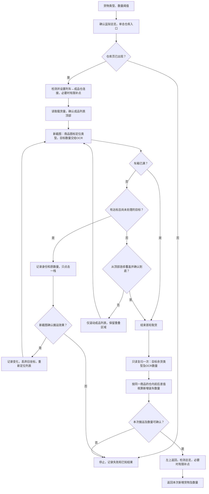

# 整顿中心成品仓取出到车厢方案

更新日期：2026-10-23。当前实现统一采用**商品图标模板识别类型、OCR 读取数量、页面状态检测控制点击**。完整取货任务及公共动作已注册；本轮只编写代码并作静态审阅，没有运行测试、离线校正或实机操作，等待用户上机调整。

## 范围与输入

起点和正常结束页面都是普通监狱（整顿中心）总览，游戏客户区为 1280×720。调用方负责先停靠云岫桥基地、不处于旅行。只从成品仓取货到列车，保留车厢已有货物。

| 业务输入 | 规则 |
| --- | --- |
| `goods`：指定货物类型 | 按名称或身份解析为商品 ID；未传、`null`、`[]` 表示尝试全拿，重复项去重 |
| `quantity_threshold`：数量阈值 | 非负整数，默认 1；仓内数量必须为正且 `>= quantity_threshold` 才可取 |

非法名称、无法解析的指定类型和非法阈值在游戏输入前拒绝，不能把无效的指定清单当成全拿。阈值是筛选条件，不是精确取货配额：仓内 20、阈值 30 时跳过；仓内 20、阈值 20、车厢只余 5 时可以点击，由游戏装入 5。

保留以下约定：

- 总览左下仓库入口只点击一次，随后检测是否进入，不补点。
- 列车↔成品仓连接、返回总览等其余界面切换，均有状态检测和有限补点。
- 按默认最大模式取货，不检测或切换最大模式，不进入定量弹窗。
- 每次只点击一个符合条件的成品栈；取货点击不套用界面切换的补点规则。
- 首轮取货结束后，进行一次只读余货复扫，再正常返回总览；复扫不再取货。
- 车厢装满是正常结束，允许成品仓仍有余货。
- 不接收菜、交订单、出售、卸货或再次生产；业务输入仍只有上述两项。

## 总体流程



连接或返回超时同样进入失败结果。图中的一次复扫是首轮结束后的完整只读扫描；取货期间点击后的局部变化检测和重新定位，不开启第二轮取货。

## 各步骤如何识别

| 对象 | 识别方式 | 用途与约束 |
| --- | --- | --- |
| 监狱总览、仓库入口 | 固定区域的事项一览、仓库快捷图标模板 | 确认入口所在页面，单击后等待仓库页 |
| 仓库页面 | 列车载货、原料仓、成品仓标题模板组合 | 返回箭头在多个页面都有，不能单靠箭头判定页面 |
| 列车↔成品仓连接 | 连接按钮选中态彩图模板，结合列车亮态、成品区亮态、原料区暗态 | 保留颜色，同时检查匹配分数及颜色误差；已经连接时零点击通过 |
| 商品类型和格子位置 | 原生商品彩图与前景掩码匹配，比较前两名候选分差 | 从完整 84×84 格子取 `[8,24,68,42]`，避开角标、数量和白条；身份按商品 ID 记录 |
| 商品库存数量 | 紧裁数量区域，调用现有 OCR 的 recognition-only 模式 | 只对目标类型读取数量；未限定类型时读取全部候选，不通过数字模板复核 |
| 列车载货量／容量 | 独立固定区域 OCR，解析 `当前量/上限` | 校验范围，判断车满；不使用商品格子的整数解析器读取分数 |
| 空仓辅助标记 | 成品区 EMPTY 模板、容量读数和列表观察 | 辅助确认空列表；单次未匹配到商品不直接等于库存为零 |
| 返回总览 | 仓库页面内定位共享 `GLOBAL_BACK`，点击后识别总览特征 | 每次补点前确认仍在仓库，目标已出现就不再点击 |

商品模板采用 masked `TM_CCOEFF_NORMED`，本批校正分数门限 0.81、候选分差 0.10。控件选中状态采用彩图 `TM_SQDIFF_NORMED` 转相似度，结合颜色误差；具体区域和门限读取各自目录，不混用灰度轮廓和颜色状态。

商品目录已生成 225 款彩图与掩码；供图覆盖 30 款，只有 ID113「涤纶」有仓库侧证据，其余已观察款来自列车侧。生成成功与截图校正状态分开记录，识别歧义不能猜成指定类型。

## 商品数量 OCR

数量入口为 `_prison_warehouse_quantity.py::WarehouseQuantityReader`，配置为 `data/meta/prison_warehouse_quantity_ocr_pc.json`，路径均相对 `plans/resonance_pc/`。

| 项目 | 当前约定 |
| --- | --- |
| 输入 | 同一轮观察中完全可见的 84×84 RGB 商品格子 |
| 主裁剪 | 格内 `[7,65,76,16]`，收紧纵向，横向保留完整数量框 |
| 备用裁剪 | 主结果不合格时，在同一格子图上改用 `[7,66,76,15]`，只再读一次 |
| OCR 调用 | 原图、无额外预处理；`recognition_only=True`，关闭方向判断及旋转 |
| 数量解析 | 恰好一条完整 ASCII 正整数 `[1-9][0-9]*`，有限置信度不低于 0.80 |
| 不可读结果 | 返回未知，保留原始文字、分数和两次尝试；不当成 0 或达标 |

不删除字母凑数字，不做 `O→0` 替换，不拼接多个文本结果，也不按当前截图最多两位来限制数量位数。OCR 服务异常向上传递；服务失败不触发区域重试。一次读数最多两次 OCR，没有新的游戏输入或等待界面变化。

本批 72 个正常格子经实际读取器离线核对：亮态 47/47、暗态 25/25，0 错读、0 拒识，共 73 次 OCR，仅一格使用备用裁剪。该结果用于供图校正，未作实机验证。人工破损不参与当前方案选型或验收；原生数字和旧截图数字模板仅保留为历史资料。

## 界面切换与补点

仓库入口仍为一次点击。连接切换与返回总览共用以下规则：

1. 用新截图先识别源、目标状态；目标已稳定时直接通过。
2. 源页面和控件都明确时才点击；输入回执不作为切换成功依据。
3. 点击后等待界面响应，再截图检测。目标状态连续两帧确认。
4. 只有仍稳定停留在原状态、同一控件可重新定位、且尚未出现目标或明确过渡状态时，才允许补点。
5. 一旦观察到目标或明确过渡状态，锁定本次切换，不再追点，只等待稳定。
6. 默认首点 1 次、最多补点 3 次，整个切换共用 20 秒总时限；等待时长按实机调整。次数或总时限耗尽就报告该步骤失败。

连接和返回的目标证据分别是「列车↔成品仓连接已选中」和「普通监狱总览已出现」。不能因一次没识别到目标就盲点；返回时已经离开仓库，就不能沿旧坐标再次点击。

OCR 的备用裁剪是同帧图片重读；界面补点则必须重新观察游戏状态。两者独立，均不能转化为重复取货点击。

## 首轮取货与列表处理

### 1. 准备

校验输入，确认总览，单击仓库入口并检测仓库页。设置列车↔成品仓连接，读取列车载货量，并通过有界滚动和列表观察确认成品列表顶部。

界面客户区统一为 1280×720。用户原图含窗口标题栏时先裁 `[1,31,1281,751]`（XYXY），不能将桌面整图坐标直接当成游戏坐标。

### 2. 当前视口筛选

在新截图中定位完整格子并识别商品 ID。指定类型时只读取相应目标的数量；未指定时尝试所有可识别类型。身份、OCR 数量和点击位置必须来自同一轮观察。

首次取得该类型的可信库存读数时保存 `before_quantity`，在其首次取货点击前必须已有这个基线；后续重定位不覆盖初值。筛选条件为：类型匹配、数量为正、达到阈值、尚未成功处理。数量未知或身份歧义的格子不点击，记录未识别项，不能据此宣称没有目标。

### 3. 点击一栈并确认

按当前界面顺序选择第一项达标目标，只点击一次。等待界面响应后重新截图，按商品 ID 观察库存减少、列表变化及适用的载货量变化，确认搬运效果；效果不明时停止，不补点该商品。

空栈会删除并重新排序，所以每次点击后丢弃旧格子索引和坐标，重置列表覆盖游标并重新识别当前列表；保留已成功处理的商品 ID。若已滚离顶部，回顶重新覆盖；成功处理的类型本轮不再点击，避免重复搬运。单个格子消失只是局部变化线索，最终将该类型余量认作 0 仍需下面的完整复扫证据。

### 4. 滚动与停止

当前视口没有可取目标时，仅滚动成品列表，保留一行左右重叠，用身份序列确认覆盖。点击、滚动或等待界面变化后都重新截图；不能把旧坐标或旧 OCR 读数带入下一轮输入。

只有从顶部连续覆盖并确认到达底部，才能结束为「没有其他达标目标」。列表不动、没识别到目标或滚动次数达到上限，都不能单独证明已到底。车厢满时直接结束首轮；此时首轮可以未扫到底，但仍进行下面的一次只读复扫。

## 复扫、数量核算与返回

1. 首轮结束后，从成品列表顶部到底部只读复扫一次，重新识别目标类型及剩余数量 `after_quantity`。不点击任何物品，也不因仍有达标货物而开启新取货轮次。
2. 复扫需区分「已见且有数量」「完整覆盖后确认不存在」「未识别或覆盖不完整」。只有不存在的结论可靠、且没有未识别格子影响该商品判断时，才能把其 `after_quantity` 认作 0。
3. 对本轮已点击且搬运效果确认的商品，按同一身份计算：

   `taken_quantity = before_quantity - after_quantity`

   不能把点击前整栈数量当成实际装入量，也不能把列车最终总量或总增量分摊给各商品。普通货物可用载货量增量辅助核对；不占货舱的物品不强制满足这一等式。
4. 车满时仍有余货属于正常结束；未达到阈值的余货正常跳过。复扫后仍有达标余货且车厢有空间时，报告未取尽，不再自动取货。
5. 本次搬运及新增数量明确后，执行左上返回的检测与有限补点，确认回到普通总览，再输出结果。正常流程不额外重进仓库。

同商品出现负差值、超过来源数量或相互矛盾的观察时，标记未知并保留证据，不取绝对值或猜测修正。未点击货物的读数未知与已点击货物的搬运结果未知应分别记录，不能将两者混成库存为零。

返回或切换仓库组合会触发游戏的 `DealWithGoods` 提交暂存调拨，因此取货过程中保持连接组合，最后按正常返回收尾。返回已确认与服务器强制回读是不同证据，不为等待提交而重放搬运或自动重进仓库。

## 结果与异常

主要输出为 `goods_taken`：**本次从成品仓新增装入车厢的货物及实际数量**，同类型合并，不包含车厢原有货物。剩余目标、扫描覆盖、停止原因和返回状态作为诊断记录，不另扩展成完整库存报表任务。

用户图中的涤纶仓内为 20，搬运后列车载货量从 74 增至 94；本次结果为涤纶 20，而非涤纶 94：

```json
{
  "success": true,
  "status": "completed",
  "stop_reason": "no_eligible_goods",
  "goods_taken": [{"goods": "涤纶", "quantity": 20}],
  "returned_to_overview": true
}
```

| 情况 | 处理 |
| --- | --- |
| 车厢满，复扫和返回完成 | 正常成功，停止原因为 `train_full`，允许有余货 |
| 完整扫描后没有达标目标，复扫和返回完成 | 正常成功，停止原因为 `no_eligible_goods`，取货清单可以为空 |
| 有未识别格子、覆盖不完整或有空间却仍有达标余货 | 记录部分完成及具体原因，不宣称全取尽；正常收尾需本次已搬运数量可确认 |
| 已发出取货点击但效果不明，或已取数量无法核算 | 停止新输入，不重放点击或整项任务；保留已知取货及未知项，不自动返回提交未确认的搬运 |
| 连接或返回次数／总时限耗尽 | 报告具体失败步骤；返回失败仍保留已确认的取货结果，不能假报已回总览 |
| 用户取消 | 停止新输入，保留当前页面和已暂存变化，不在取消处理里自动返回或继续提交 |

数量未知不填 0。成功表示本次约定操作与收尾完成，不表示成品仓已经清空或服务器库存经过强制回读。

## 实现与调用

| 内部步骤 | 职责 |
| --- | --- |
| `prepare` | 输入校验、一次进入仓库、连接检测与补点、容量基线及列表起点 |
| `take_pass` | 一轮筛选与取货，每次点击后重新观察，维护按 ID 的处理记录 |
| `rescan` | 只读复扫、覆盖判定、剩余数量与实际新增量核算 |
| `return_overview` | 在搬运结果明确后返回，检测总览并有限补点 |
| `summarize` | 纯汇总取货、未完成原因和返回状态，不执行游戏输入 |

任务名为 `withdraw_product_warehouse_to_train_pc`，公共动作为 `resonance_pc.withdraw_product_warehouse_to_train`。复用现有截图／输入服务、共享返回键与点击坐标处理，以及公共 `TransitionProbe`、`TransitionPolicy`、`run_transition` 机制；商品目录、控件目录和数量 OCR 各自独立。不改收菜任务，也不新增 GUI 或用户业务参数。

其他任务通过标准引用调用，例如：

```yaml
transfer:
  action: aura.run_task
  params:
    task_ref: tasks:withdraw_product_warehouse_to_train_pc.yaml:withdraw_product_warehouse_to_train_pc
    inputs:
      goods: [涤纶]
      quantity_threshold: 20
```

`goods: []` 表示尝试全拿；任务输入的 ID 写成字符串，例如 `["113"]`。直接调用公共动作也支持单个名称或 ID。已知不受模板目录支持的指定商品会在游戏输入前拒绝。

实现文件（均相对 `plans/resonance_pc/`）：

| 文件 | 职责 |
| --- | --- |
| `src/actions/prison_warehouse_pc_actions.py` | 四服务注入、异步工作线程、目标租约和取消、框架失败状态 |
| `src/actions/_prison_warehouse_runtime.py` | 五阶段流程、带新截图的有限补点、滚动覆盖、单次取货效果及收尾 |
| `src/actions/_prison_warehouse_ui.py` | 纯截图识别；动态行锚点、商品身份、紧裁数量 OCR、独立容量 OCR |
| `src/actions/_prison_warehouse_ledger.py` | 输入解析和按商品 ID 的数量差核算 |
| `tasks/withdraw_product_warehouse_to_train_pc.yaml` | 仅两个业务输入，声明任务及公开返回字段 |
| `data/meta/prison_warehouse_runtime_pc.json` | 页面区域、识别门限、列表几何及运行等待／次数参数 |

默认每次仅在成品区拖动 72 像素，保留完整商品行重叠；回顶和到底均需两次输入后的稳定视口，以及相应行相位／边界几何证据。达到滚动次数限制只表示覆盖未确认，不作为列表端点。每次搬运后重新从顶部建立覆盖。

`success: true, status: partial` 表示已确认本次搬运数量且已正常返回，但还有识别或覆盖问题，或有空间仍有达标余货。调用方需同时查看 `status`、`issues` 和 `remaining_targets`。`success` 不代替全取尽判定。

业务失败以 `StopTaskException(success=False)` 终止，完整结果写入日志并附在异常 `details.warehouse_transfer`；当前框架失败任务不会渲染普通 `returns`。取消透传并附当前诊断，不启动返回或其他清理点击。正常返回只说明页面切换确认，`server_readback_confirmed` 固定为 `false`。

## 素材、证据与当前进度

- 控件：`data/meta/prison_warehouse_transfer_templates_pc.json`，已提取 10 张模板；共享返回键复用 `GLOBAL_BACK`。
- 商品图标：`data/meta/prison_warehouse_goods_templates_pc.json`，记录生成、支持及截图校正状态。
- 数量 OCR：`data/meta/prison_warehouse_quantity_ocr_pc.json`；当前正常供图摘要为 `development/template_sources/warehouse_transfer/quantity_ocr_calibration.json`。
- 原图、人工标签及历史实验索引：[素材来源说明](../../plans/resonance_pc/development/template_sources/warehouse_transfer/README.md)。旧数字模板和破损实验不进入当前数量决策。
- 数量读取、容量读取、动态列表识别、滚动覆盖、任务串联和点击效果确认均已接入；等待、锚点和边界参数仍需实机调整。

本机游戏脚本证据位于 `Patch/Script/UIPrisonWarehouse/`，原件为 Lua 字节码；此前已从函数指令、常量及保存的源代码行号核对以下规则：

| 游戏规则 | 设计含义 | 来源 |
| --- | --- | --- |
| `ProductAndTrain=3`；最大模式点击直接调拨 | 先设置连接，按默认最大取货 | `ViewFunction.lua` 原始 L162–193 |
| 普通货物按车厢余位截断；零余位先阻断 | 满车正常结束，实际装入按数量差核算 | `Controller.lua` 原始 L263–302 |
| 空栈删除后重新排序 | 每次输入后重新定位，不沿用格子索引 | `DataModel.InitWarehouseData`、`Controller.ExchangeGoods` |
| 返回或切换组合提交暂存变化 | 中途不换连接，不重放提交 | `ViewFunction.lua` 原始 L5–8、L190–193；`DataModel.lua` 原始 L299–425 |

| 原始文件 | SHA-256 |
| --- | --- |
| `UIPrisonWarehouseController.lua` | `137D83803B86751182BE636A815782F96B69476908211C0978D675EC67D58D1E` |
| `UIPrisonWarehouseDataModel.lua` | `996FB8084CE357A763D1EB0BE5C135D80AB184A477AC94833F571BB8CBE09072` |
| `UIPrisonWarehouseViewFunction.lua` | `4A529EA9BD727011CD38AA059C30D068B7EC7EAA669CCDC149B869C55650423A` |

与 [收菜任务](resonance-pc-product-workshop-collection.md)、[整顿中心界面研究](resonance-pc-reforming-center-ui-operations.md) 分开维护。本轮实现取货任务并静态审阅，没有执行项目测试、离线校正或操作游戏；上述既有供图 OCR 数据不是本轮新增验证。
