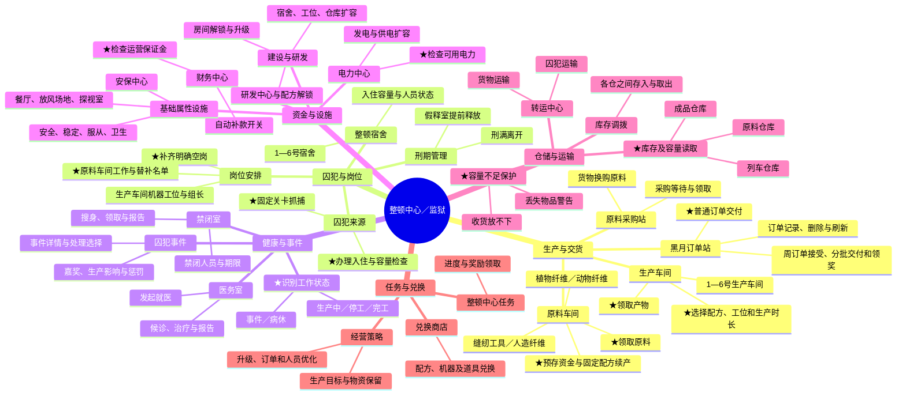

# Resonance PC 整顿中心功能层级与自动化范围

本文记录整顿中心（别称监狱）的功能划分、首版自动化范围和已核对的玩法边界，供后续逐界面实现使用。资料基线为 2026-10-04 检查的本地 PC 安装包及当前 `plans/resonance_pc` 源码。

首版定位为按用户既定配置完成一次经营巡检：补款补料、收货交单、缺岗补人。配方选择、预算、生产时间和房间优先级由用户确定；智能调度、升级收益计算及长期发展策略后置。

这是设计与研究记录，不是完整自动化已实现或实机验收通过的说明。逐界面操作契约见 [整顿中心界面操作设计](resonance-pc-reforming-center-ui-operations.md)，可复用任务及调用边界见 [基础任务设计](resonance-pc-reforming-center-basic-tasks.md)。

## 功能层级

图按玩法功能划分，不表示房间的物理位置。★表示首版计划自动化的功能，不表示已经完成。

## 首版经营流程

主链为原料车间消耗预存资金生产原料，生产车间消耗材料制造产物，黑月普通订单交付产物。原料采购站是独立的货物换购途径。人员入住、岗位分配和替补维护为生产提供人手，财务保证金与电力为经营提供条件。

“补货”需要拆成不同操作：原料车间补预存、原料收取、允许的采购，以及生产车间按库存续产。“补人”需要区分未入住囚犯、已入住人员和实际空岗。监狱满人不代表车间满岗。

建议单次巡检采取有限遍历：读取当前状态，领取能入库的产物，提交允许的订单，再补款、补岗和续产，最后报告未处理原因。仍在生产的任务跳过，不等待其完成；仓库已满时先寻找允许的交付机会，没有解决途径则报告，不确认丢货。

固定关卡抓捕属于后续补齐人员来源的步骤，不是每次发现空岗都无条件执行。应先使用已有可用人员、办理现有储备入住，再按明确的次数、逮捕令和疲劳限额决定是否抓捕。

## 用户配置与默认边界

| 用户决定 | 脚本按配置执行 |
| --- | --- |
| 房间、配方、生产时长及优先级 | 读取状态、领取、在条件满足时续产 |
| 补款目标、单次支出上限及钱包保留额 | 核对余额与预算后执行对应补款 |
| 需要补齐的普通岗位和替补名单 | 仅使用符合条件的人员补明确空位 |
| 可交付物资及保留量 | 读取需求和拥有量，提交允许的普通订单 |
| 是否启用采购及允许的换购物资 | 按成本、库存和容量开始或领取采购 |
| 固定抓捕关卡及资源上限 | 限额内战斗、抓捕、回监狱办理入住 |

默认不取消现有生产、不跨车间抢人、不使用加速或刷新道具、不删除普通订单、不接受新周订单、不假释、不升级扩容、不改变财务自动扣款开关。以上操作需要明确配置或独立任务。

事件与病休首版先保证能识别、定位和报告。只有处理后果已核对且策略明确的分支才自动执行；未知事件不能统一当作惩罚处理。

## 当前代码已有能力

| 能力 | 当前入口 | 已有边界及剩余工作 |
| --- | --- | --- |
| 进入整顿中心 | `tasks/enter_reforming_center_pc.yaml`、`resonance_pc.enter_reforming_center` | 从主界面经头像菜单进入；总览标识确认。不能等同于从任意子页面恢复总览。 |
| 办理已有囚犯入住 | `tasks/admit_prisoners_pc.yaml`、`resonance_pc.admit_all_available_prisoners` | 有满员、无储备和办理结果分支；不包含抓捕或工作岗位分配。 |
| 找到指定房间并点击 | `tasks/navigate_reforming_center_room_pc.yaml`、`resonance_pc.navigate_reforming_center_room` | 固定位置模型与 OCR 锚点、受限区域拖动、点击安全区；当前返回 `room_clicked`，仅证明已发出点击。部分房间先进入选中和放大状态，还需点击功能按钮；应补两阶段打开及目标页面确认。 |

对应代码位于 `plans/resonance_pc/src/actions/reforming_center_pc_actions.py`，房间目录位于 `plans/resonance_pc/data/meta/reforming_center_rooms_pc.json`。当前三个任务均有客户端分辨率前置检查。这里记录源码能力，本次文档研究没有重新运行游戏验收。

## 当前包核对得到的实现约束

1. 原料车间收货可以不中断生产，但生产中隐藏预存按钮。为了补款而终止任务是另一项决策，不应隐含在维护动作中。
2. 原料车间工作名单与替补名单独立；生产中普通人员不能编辑，正在替补的人员存在不能直接移除的限制。成品车间的人员布置与排产也属于不同页面。
3. 普通订单和采购界面的拥有量汇总成品仓、原料仓与列车仓。生产排产的材料来源条件不应直接套用订单规则，应以其自身页面及逻辑核对。
4. 财务保证金与原料车间预存是独立余额。当前包上限分别为 200 万和 250 万，配置上限不是用户允许支出的金额。
5. 病休入口发起就医，可能入院或进入候诊；医务室床位点击用于查看详情，不是再办理治疗。
6. 收货和禁闭搜身可能提示领取后丢失部分物品。此类提示默认取消并报告，不能与普通奖励关闭或安全确认共用无条件点击。
7. 仓库调拨会先积累本页改动，返回时提交。仓库“返回”不是撤销；首版只读库存时不能随意点击物品。
8. 普通订单与周订单是不同交付流程。新周订单接受不可撤销；普通删除会启动刷新，不能假设一定存在确认挡板。
9. 采购的一键按钮随状态在领取和采购之间变化；一次点击后需要重读，不可在原位置连点。
10. 总览点击房间不一定直接打开功能页面。普通功能房间的 `isInitial=false` 分支先选中和放大房间，显示功能按钮后再打开；宿舍、生产车间有独立入口。导航完成判据必须是目标功能页面，而不是一次地图点击。
11. 当前成品人员编辑 `UIPrisonEdit` 有两层提交：人员选择确认只更新本地布置，主页面保存才提交。原料人员名单确认则直接提交；不能共用一套确认即完成逻辑。

## 素材与证据边界

研究读取当前游戏包的 `Asset/ui/prison/`、`BinaryConfig/` 和 `Script/`。原生图片、预制体层级及直线型按钮绑定用于确定界面入口；Production、Prison、Room、HomeGoods、Order、Tag、Event 等数据用于还原名称、规则和识别字典。

九张主状态预览及五类工作气泡符号已离线生成并查看；预存弹窗、完整人员列表及部分动态排版尚未完整合成。合成图中的金额、库存与产物数是明确的示例，不表示账号状态，也不证明 OCR 阈值、坐标或点击流程通过实机验收。预览和原始资源留在 `.pytest_tmp/reforming_assets_20261004`，不作为本文的版本化附件。

客户端脚本反编译存在局部变量、布尔表达式和跳转错误。直线赋值、明确按钮路径和提示文本可作为界面设计证据；损坏的复杂条件不能直接复制为自动化逻辑。普通订单刷新时长、部分生产材料跨仓规则、入口和返回堆栈、动态列表布局仍需核对。

可复查的客户端逻辑入口包括：

- `UIMaterialProductionEdit`：`RefreshLeft`、`OpenBatchPanel`、`SelectFormula`、`SelectPrisoner`、`TryStorageCoin`、`TryStartProduct`、`TryGetProduction`。
- `UIPrisonProductionEdit`：`RefreshRequirePanel`、`TrySetProductPlant`；物理工位状态由 `UIPrisonMain/PrisonController` 负责。
- `UIPrisonContractManage`：`RefreshOnShow`、自动开关和补款回调。
- `UIHYOrderStation`：`RefreshOrderInfo`、`DeliverOrderClick`、周订单接受和数量交付回调。
- `UIPurchaseOrder`、`UIPrisonWarehouse`：采购卡片和容量、仓库调拨与退出提交。
- `UIMedicalRoom`、`UIPunishmentRoom`、`UIPrisonerEvent`：异常页面；`UIPrisonEdit` 是当前物理车间人员编辑入口，包中保留的旧 `UIPrisonManage` 需单独识别，不能套用其保存规则。

具体页面的动作、输入和验收标准统一维护在 [界面操作设计](resonance-pc-reforming-center-ui-operations.md)，避免把玩法层级误当成一个房间一个大动作的实现结构。
