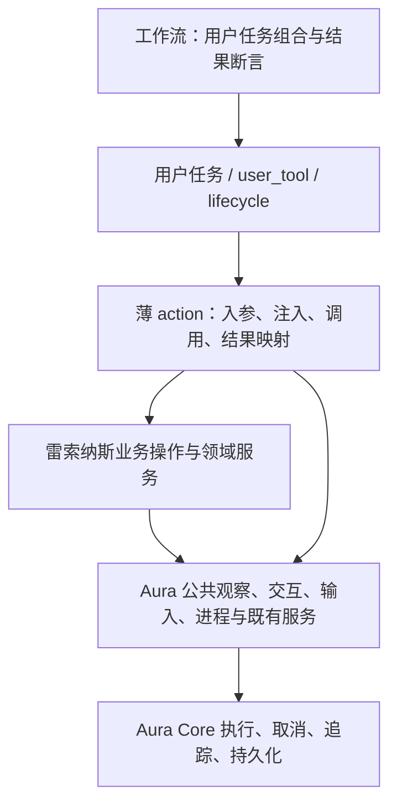

# 雷索纳斯 PC 非深潜任务分层设计

日期：2026-10-22。状态：设计已确认，批次 1、2 已完成离线验证；批次 3 已实施，待获授权验证。
首次设计整理仅新增本文档；批次 1 的实际接口和迁移范围见 [公共观测服务](observation-service.md)。
批次 2 的实际接口和迁移范围见[公共交互服务](interaction-service.md)，结果见[交互批次验证](interaction-batch2-validation.md)。批次 3 的实际边界见[执行 facade](execution-facade.md)。后续批次仍为设计，不代表已全部实现；首批结果见[首批验证记录](observation-batch1-validation.md)。本次未执行打包。

## 1. 范围与基线

范围为 `plans/resonance_pc` 的非深潜任务及其依赖的 Aura 公共能力。
基线盘点为 27 个任务 YAML、46 个定义：9 个 user_task、3 个 user_tool、31 个 internal、2 个 lifecycle、1 个 orchestration。
这些数量用于定位当前规模，不作为必须保持的架构指标；迁移以当前工作区文件为准。
深潜任务、检测器及其专用 worker 不在本次改造范围；共享框架变更仍须考虑其兼容性。
基线提交为 main 的 `84e83d03`；设计以包含大量未提交变更的当前工作区为准。
既有工作区改动属于基线，不通过清理、重置或批量覆盖处理。

目标不是增加层数，而是让任务表达用户意图，让业务操作复用，让公共机制只有一个实现。
YAML 与 Python 是实现手段，不决定层级；一个 Python runtime 可以是合适的领域实现。
不把每次点击变为一个任务，也不引入新的页面描述 DSL 或通用业务状态机配置语言。

### 1.1 已有事实与设计提案

| 已有事实 | 本文提案 |
| --- | --- |
| aura_base 已提供 app、screen、controller、OCR、vision、config、wait、interaction | 提升 action 内的通用等待/交互机制为可注入服务，原 action 委托同一实现 |
| interaction 已支持 timeout、stable_scans、中心容差、required、after_click_sec | 补足有效观察、总预算、后置条件和可控补点，避免另造第二套点击能力 |
| `_template_observation.py` 已区别未知与有效阴性 | 将其有效性原则迁入公共观察适配，游戏规则仍留领域 |
| `aura.run_task` 调用 orchestrator 并校验非空 user_data 和严格类型断言 | 保留任务边界，抽公开的 Python 调用入口，移除业务代码手组 injector |
| 普通模板匹配已有 VisionService 与 PreparedTemplate | 收敛重复 cv2 模板匹配；不机械替换游戏颜色、字形和一致性算法 |
| persistent_data、state_store、event_bus 已广泛使用 | 继续复用，禁止另造存储和进度总线 |

关键源码依据：`plans/aura_base/src/actions/{interaction,wait,vision,ocr}_actions.py`、
`plans/aura_base/src/services/{vision,process_manager}_service.py`、
`packages/aura_core/engine/action_injector.py`，以及下文列出的 resonance 文件。
下文新类型、服务名和方法签名均为设计建议，不是现有 API 声明。

## 2. 目标职责与依赖方向



工作流只组合稳定的任务接口，不依赖私有节点 ID，也不解析动作内部临时字段。
用户任务定义输入、主要阶段、业务返回与收尾；独立可用、需要完整收尾的能力保留任务边界。
薄 action 负责框架适配，不持有跨业务复用的核心流程；简单动作可直接调用 Aura 公共服务。
领域操作负责页面语义、资源约束、恢复策略、交易决策及业务后置条件。
公共服务负责截图有效性、识别调用、坐标转换、轮询、输入、取消和证据，不认识“投资成功”等游戏语义。
纯 policy、reader、数据对象可保持普通 Python 模块/对象，不要求每个域都注册 singleton service。

允许同层领域操作组合公开领域接口；禁止跨 action 导入私有业务函数作为长期接口。
领域服务不反向调用用户 action。确需子任务时，由任务编排层或其显式执行适配器调用执行 facade。
底层服务不得依赖雷索纳斯模板、城市名单、道具或页面名称。
`bridge_app_service`、`bridge_controller_service` 属合法 replace 扩展，继续保留。

## 3. 最小公共能力增量

| 建议归属 | 增量 | 不做的重复建设 |
| --- | --- | --- |
| aura_base ObservationService | 有效截图、同帧探针、稳定观察、共享预算 | 不另写 OCR 或模板匹配内核 |
| aura_base InteractionService | 基于观察的点击、转场确认、有界补点 | 不另保留 action 内独立轮询循环 |
| aura_core 现有执行/取消设施 | operation scope、已追踪 worker 的公共调用契约 | 不创建每个游戏一套线程池、取消标志和 join 循环 |
| aura_core 公开执行 facade | typed action 调用和完整子任务调用 | 不把 injector/renderer 装配暴露给业务 |
| 既有 app/controller 输入契约 | backend 能力、受控拖动、取消释放 | 不把 bridge 私有对象传给业务 |
| 既有 process_manager / target_runtime / windows_diagnostics | 发现、接管、确认目标、按已核验窗口关闭 | 不新建游戏专属进程管理器 |

ObservationService 与 InteractionService 可分别作为可注入服务；预算、结果类型为普通值对象。
若两服务初期共享内部模块，应保持职责可区分，不为拆文件提前引入复杂插件协议。
原 `plans/aura_base/find_*`、`plans/aura_base/wait_*`、`plans/aura_base/find_*_and_click` 保留名称与兼容参数，统一委托新服务。
`after_click_sec` 只表示等待时间，不自动升级为“操作成功”。
不以新 API 强制全量改写既有任务；明确旧布尔返回的语义边界后分批迁移。

## 4. 观察、预算与结果类型

以下伪代码仅表达契约；实现时优先扩展既有类型，避免复制同义结构。

```python
Presence = Literal["present", "absent", "unknown"]

@dataclass(frozen=True)
class Frame:
    id: str
    captured_at: float          # monotonic
    target_identity: object    # PID/create_time/HWND 等已核验目标
    image: object
    color_space: Literal["RGB", "BGR", "GRAY"]
    capture_roi: Rect           # client 坐标；明确 x,y,width,height
    coordinate_transform: object

@dataclass(frozen=True)
class Observation:
    state: Presence
    frame_id: str | None
    value: object               # 保留 MatchResult / OCR / 领域读数
    semantic_key: object
    client_center: Point | None
    reason: str | None
    evidence: tuple

class OperationScope:
    cid: str
    deadline: float             # monotonic，所有子步骤共用上界
    cancellation: object
    target_identity: object
    def child(self, timeout: float) -> "OperationScope": ...
    def checkpoint(self) -> None: ...

class ObservationService:
    def observe(self, probes, *, scope, roi=None) -> object: ...
    async def observe_async(self, probes, *, scope, roi=None) -> object: ...
    def wait(self, observe, accept, *, scope, stability) -> Observation: ...
    async def wait_async(self, observe, accept, *, scope, stability) -> Observation: ...

class InteractionService:
    def click(self, source, *, scope) -> "InputReceipt": ...
    async def click_async(self, source, *, scope) -> "InputReceipt": ...
    def transition(self, observe, classify, *, scope, policy) -> "TransitionResult": ...
    async def transition_async(self, observe, classify, *, scope, policy) -> "TransitionResult": ...
```

探针是少量 Python callable 或简单探针对象，默认模板/文字场景提供便捷方法。
调用者不需要手工拼装上述所有类型；普通点击只提供模板、ROI 与 timeout 即可。
复杂游戏操作才提供 semantic_key、页面分类和业务后置条件。
同步/异步入口共用结果、预算与策略内核；异步入口统一使用 core 已追踪 worker 设施。
同步 action 可直接使用同步入口，不为每次探针创建事件循环，也不在事件循环线程中阻塞等待它自己。

### 4.1 有效性与同帧约束

`absent` 只来自有效截图、有效 ROI 和成功完成的识别；截图失败、模型/模板异常均为 `unknown`。
当前 `find_templates_in_set` 截图失败可返回 count=0，消失等待又以 count=0 判断，必须一并收敛。
OCR 的 found=False 同样不能直接证明文字消失；识别失败与有效未命中必须分开。
内部 wait 必须消费完整状态，不得经过丢失有效性信息的旧 bool 适配后再判断消失。
空模板集合、非法 ROI、不可用模板属于配置/识别错误，不允许以“全部消失”成功。
单个复合观察内的源控件、目标页、遮罩、资源读数尽量使用同一 Frame；不能拼接跨帧事实确认状态。
若 probe 失败，仅该 probe 为 unknown；决策所需探针有未知时，决策不得当作阴性成立。
可证明目标已达到时允许提前成功，但必须由领域分类器明确目标证据充分。

Frame 保留截图原点、尺度与目标身份；ROI 局部点到 client 坐标只转换一次。
图像只读共享，领域若需修改像素须显式复制；工坊既有 RGB→BGR 等转换必须有明确适配，不能默默改变颜色空间。
点击前校验坐标有限、位于有效 ROI/客户区、仍指向同一目标，拒绝过期窗口身份。
输入发出后作废本操作中用于继续点击的旧观察；后续补点和确认必须取得新的 Frame。
原生 1280×720、地图变换和游戏坐标留在领域；公共层不默认所有计划使用此分辨率。
模板由既有解析器加载并使用 PreparedTemplate；保留 mask、灰度、预处理、算法与阈值。
同帧批量匹配使用 VisionService 批量接口，不以增加截图次数模拟批处理。

### 4.2 时间与稳定性

总 deadline 从业务操作开始计算，覆盖截图、识别、比较、sleep、输入前检查和补点。
子步骤只缩短上界，不能每次 probe 或 retry 重新获得完整 timeout。
截图或识别返回后、稳定比较后、发送输入前都检查预算和取消；迟到结果仅作诊断证据。
旧查找/点击入口的 timeout=0 保持“只探测一次、不轮询”，不解释为创建一个立即过期的局部 deadline。
单次探测继承外层 operation/node 的有效预算和取消约束；外层已耗尽时不启动探测，也不发送输入。
没有外层 deadline 时保留该入口的一次探测语义，不借重构偷偷新增超时默认值；新领域操作应显式提供总预算。
连续稳定按“有效帧数 + semantic_key + 必要位置容差”确认，unknown 清空连续计数。
semantic_key 可包含页面、按钮身份、槽位、选中对象或交易身份；不能只比较坐标或置信度。
不要对同一 frame_id 重复计算稳定次数；一次截图运行多个探针仍只算一帧。
可选最短稳定时长用于动画场景；不将其强制施加于所有简单点击。

## 5. 输入、业务确认、重试与失败

必须区分三件事：观察到控件、输入请求已发送、业务后置条件已确认。
`InputReceipt` 表达发送状态、目标身份、时间与输入序号；不承诺游戏已接受输入。
`TransitionResult` 表达目标页面/效果证据与发送记录；领域结果再说明交易、恢复或生产结论。
旧点击 action 的 True 最多表示已有输入发送，不等价于购买成功或页面已进入。

普通页面转场策略：先看目标是否已达成，再确认源控件，点击，等待目标，必要时有界补点。
每次补点必须重新截图、核验源页面/控件身份并重新定位，禁止复用旧坐标盲点。
领域可采用更严格的单向停止策略：生产工坊补人现有行为是源首次消失或 unknown 后，
本次操作永久禁止后续补点，只等待目标；即便源后来重新出现，也不能重新开放补点。
InteractionService 的 policy 必须支持该锁存状态，不能以统一重试策略放宽领域约束。
目标页成立时停止；源页不明确、未知连续超限、预算耗尽时失败并保留证据。
同时限制总 deadline 与 max_clicks；固定次数等待不能替代实际效果确认。
`_reforming_center_clicks.py` 中的次数式等待迁入上述机制，房间身份仍由领域判断。

购买、投币、投资、词缀刷新、消耗恢复品等不可按普通导航策略补点。
这些操作默认一次提交；响应不明进入“结果未确认”，先读取余额/数量/交易状态再由领域决定。
不能确认幂等或未执行时，不自动重发；框架 retry 也不得绕开该约束。
取消发生在提交之后时，报告取消并保留最后可知输入阶段，不能声称业务已回滚。
业务后置条件包括需要时回到约定页面；“点击后睡眠结束”不构成后置条件。

错误保持可机读 code、阶段、最后观察、输入记录、耗时与 evidence 引用。
失败证据复用现有 failure_evidence 链路；避免每帧落盘，保留有界关键帧和最后有效帧。
截图失败时记录原因和目标身份，不能伪造一张“当前帧”；旧帧必须标注时间。
取消优先传播 CancelledError，不转换成普通识别失败或 success=False 后继续执行。

## 6. 生命周期、线程与注入约束

`service_info` 默认 singleton；当前 frame、预算、取消 token、业务 session 不得放入可变单例字段。
每次业务操作显式创建 scope，CID 隔离；可共享的只有不可变目录、受控缓存和线程安全资源。
业务 session 继续使用既有上下文/状态存储机制，不能由服务实例记住“当前任务”。
框架负责把取消、追踪上下文和事件关联传入 worker；领域通过公开 scope 检查取消。
输入仍需目标独占或既有调度互斥；CID 隔离本身不能避免两个任务同时点击同一窗口。

取消时先设置协作停止标记，禁止新的输入，再等待已追踪 worker 收敛并回收异常。
单次同步截图/OCR 无法安全强杀线程；deadline 只能拒绝迟到结果授权输入，不保证硬实时返回。
worker 必须在阻塞调用返回后、每次输入前再次检查停止标记，不能仅在循环入口检查。
正常取消完成应等已在飞输入/worker drain；不能只 cancel asyncio 包装就认为底层已停。
若底层永久阻塞，join 也可能永久等待：调度器须有 drain 超时、诊断和目标隔离状态。
隔离期间禁止新任务复用该输入目标；不得宣称安全完成，也不得强杀用户正常应用来清理线程。
需要可强制终止的识别任务时，应另立可终止进程 worker 设计；本批不承诺顺手解决。
输入后端取消/异常必须在 finally 释放已按下按键/鼠标，且释放操作绑定原已核验目标。

## 7. 公开执行 facade 与商贸组合

现有组合商贸直接调用货运/客运 action，客运又导入大货运模块的私有操作。
装饰器只附 metadata；直接 import 调用不会获得完整注入、middleware 和节点生命周期。
这不意味着完全没有追踪：底层 runtime 的 trace 和 tracked worker 仍可能存在。
优先将货运/客运共用的入城、交易、疲劳恢复、状态读取提取为公开领域操作。
组合商贸调用这些操作或稳定任务接口，不通过 Python action 互调模拟任务编排。
当前组合商贸明确拒绝 auto_bento；迁移保持该限制，不扩大功能范围。

```python
class ExecutionFacade:
    async def call_action(self, action_ref, values, *, scope) -> object: ...
    async def run_task(self, task_ref, inputs, *, scope,
                       result_assertions=None) -> object: ...
```

`call_action` 面向已求值的 typed Python 参数，沿用框架注入、middleware、worker/trace 管理。
facade 是绑定当前调用上下文的受限 handle，由 core 的注入/执行边界提供；不将当前 engine/context 存入全局单例。
不得再次将普通字符串作为模板渲染；YAML 原始模板参数仍由原节点入口只渲染一次。
只包装 ActionInjector 不会自动获得 NodeExecutor 的 timeout/retry/loop；facade 不承诺这些语义。
需要节点循环/重试的场景放回任务定义；业务操作内部只执行明确且安全的领域恢复策略。
`run_task` 使用 canonical task_ref 并进入现有 orchestrator.execute_task，保留完整子任务收尾。
共享同一任务引用解析、跨包限制、取消传播、父子 CID 与返回校验，不能另造平行执行器。
返回仍为非空 user_data；严格断言保持类型相等，不能让 True 等价于整数 1。
子任务失败和取消携带原 evidence；不得只包装为丢失上下文的文本错误。

`city_trade_flow_pc_actions.py` 手组 ActionInjector/TemplateRenderer 的投资、恢复入口优先迁至 facade。
投资仍需确认 shop_page、mode、target_level 和 invested/skipped，之后才继续交易。
恢复若依赖完整任务收尾则用 run_task；明确只是基础 action 时才用 call_action。
禁止为了少一次任务调用，直接执行投资/恢复内部节点，跳过返回主屏、状态刷新等收尾。

## 8. 分域归属与必须保持的规则

| 领域 | 收敛方向 | 必须保留 |
| --- | --- | --- |
| 货运、客运、组合商贸、预览 | 公开商贸操作；规划与执行分离；共享导航/交易/恢复 | 行情冻结快照、求解目标、疲劳预算、终点卖出与既有进度结构；预览不发送输入 |
| 投资、黑月、回收、拖车 | 各自保留业务流程，复用观察和转场；消费提交单独策略 | 等级、容量、数量、余额和返回页面确认，不因输入成功宣布完成 |
| 气泡水、便当恢复 | 恢复领域操作复用公共机制，由商贸按规则调用 | 疲劳读数新鲜度、使用限制、可用休息点、恢复次数和组合 auto_bento 限制 |
| 整顿中心、收容、原料及生产工坊 | 共享房间定位和页面操作，生产/收容策略分开 | 房间身份、选中状态、原料/产能规则和完成页确认 |
| 玩家、角色、仓库、配队 | reader/policy 保持普通对象，少量共享操作按需注册 | profile.status 等数据对象、仓库容量、角色身份、配队约束，不统一成字符串状态 |
| CT/GP 战斗 | 战斗领域 runtime 调用公共观察、输入和等待 | 战斗模式、结算/失败识别、循环上限与终止原因 |
| 无垠乱斗 | 保留薄 action/runtime/vision/policy 结构 | 选角、装备、投币、战斗规则，CID session 和事件 schema |
| 词缀 | 保留薄 action/runtime/vision/policy 结构 | 词条识别、停止策略、资源消耗和结果不明时禁止盲刷 |
| 启动、关闭 | lifecycle 任务使用扩展后的进程/目标服务 | 手动启动接管、目标唯一性、窗口规格和优雅关闭身份约束 |

市价 HTTP、行情冻结快照、交易求解、城市/店铺数据、疲劳与选角规则均是领域能力。
当前框架没有完整通用对等物时保留领域实现，不为“全部使用框架”抽象出空壳服务。
可达目标是通用机制全部走框架契约；游戏知识和业务策略仍在 resonance。

### 8.1 视觉与导航边界

`_reforming_center_room_templates.py` 普通匹配、`player_data_pc_actions.py` 模板读数路径、
`_trade_goods_investment_vision.py` 普通模板调用迁到 VisionService，保留算法与预处理参数。
颜色、字形拼接、双核识别一致性、容量规则继续在领域，不强改成 OCR。
迁移需注意最低值型匹配算法、阈值方向、mask 与中心坐标，不能只替换函数名。
`navigation_service` 是小地图/A*/角色路径跟随，不替代城际地图拖动或菜单/房间导航。
`_intercity_map_drag.py` 不再读 `app.controller.bridge`，改向输入契约查询能力并请求安全手势。
系统起拖损失、后端能力和按下/释放在输入层；原生地图坐标、连续盲拖批次不 OCR、惯性策略留领域。
惯性停止所需具体手势由领域选择，后端保证执行/释放契约，不推断游戏地图规则。

### 8.2 进程与窗口边界

启动已使用 process_manager；不能把关闭的 psutil/Win32 代码简单换成当前 stop_process。
后者依赖已记录进程，并存在按标题回退关闭多进程的路径，不满足游戏目标身份约束。
扩展既有服务以发现/接管手动进程，返回绑定 executable、PID、create_time、HWND 的目标句柄。
候选不唯一时拒绝；wait_target 在预算内等待目标窗口，并在发送 WM_CLOSE 前复核身份。
WM_CLOSE 仅发送到已核验 HWND；关闭后确认目标退出，PID/HWND 重用不得误判或误操作。
强制终止仅按任务明确的 `force_after_timeout` 策略执行；保留其当前默认值 true 和可关闭选项。
不得新增独立于该参数的自动升级，也不得在本轮重构中擅自取消既有默认行为；升级前仍需复核目标身份。
窗口规格继续使用 windows_diagnostics.check/ensure_window_spec，不另写分辨率调整器。

## 9. 按依赖顺序实施

每批只迁一个可审查闭环；没有消除旧调用点前，不提前删除共用助手。
框架新服务先增量接入，既有公开参数/返回外观保持；领域迁移不得混入资产清理或无关功能扩展。
修正 unknown 被误判为 absence 是明确行为修正，必须盘点全体调用方，不能假设仅影响非深潜。
深潜与其他计划虽不在领域改造范围，也属于公共 action 变更的兼容影响面。

| 批次 | 具体范围与样板 | 退出标准（后续实施时评审） |
| --- | --- | --- |
| 0 契约冻结 | 固定现有任务引用、输入、returns、关键业务限制与证据字段 | 每个变化可区分兼容调整/行为修复；本轮不执行检查 |
| 1 观察与预算 | core scope/已追踪 worker 契约、aura_base 观察服务；普通工坊房间模板匹配作为只读样板；wait 统一委托 | 有效性和总 deadline 生效；同帧、坐标、颜色空间明确；取消和在飞探针收尾有公共实现 |
| 2 交互与转场 | InteractionService；既有 interaction action 委托；`_template_click_transition.py`、`_reforming_center_clicks.py`；进入指定房间闭环 | 源重确认、目标确认、有界补点，取消后无新输入；迟到证据不授权；旧 action 不再维护独立轮询 |
| 3 执行入口 | core facade；city_trade 的投资/恢复手组装配 | 无业务侧 injector/renderer 装配；完整子任务收尾与严格返回不变 |
| 4 商贸领域 | city_trade/passenger/combined；投资、黑月、回收、拖车及恢复 | 客运不导入货运私有函数；组合不互调 action；消费无盲重试；预览仍只读 |
| 5 生产和数据 | 整顿中心其余流程、收容/工坊；玩家/角色/仓库/配队 | 通用模板匹配收敛，领域读数与数据返回兼容 |
| 6 战斗与刷取 | CT/GP、词缀、无垠乱斗 runtime | 移除私有 poll_until 导入和自建取消/join；保留 policy/vision 分工 |
| 7 输入和生命周期 | `_intercity_map_drag.py`、bridge 扩展、启动/关闭 | 无业务侧 bridge 内部访问；目标身份和关闭约束不减弱 |
| 8 收尾 | 非深潜调用面及公共兼容入口 | 没有永久双实现；保留必要兼容外观和领域算法，不追求文件数最少 |

第一批只迁普通工坊模板观察；第二批完成公共交互后，选整顿中心“进入指定房间”作为首个完整业务样板。
该样板有源/目标与身份确认，且不涉及购买，可用于后续评估分层价值；本轮不执行它。
公共“模板/文字消失”有效性修复需同批覆盖公共入口，避免只保护一个游戏助手。
下一样板选货运调用投资：检验完整任务生命周期、业务返回与资源操作重试边界。

旧助手的删除条件和归属：

- `_bounded_observation.py`：预算/轮询进入公共观察机制；所有消费者迁完后删除，勿永久转发。
- `_template_observation.py`：有效性和坐标适配进入公共层；特定页面识别留领域 reader。
- `_template_click_transition.py`：通用转场进入 InteractionService；领域分类器不搬进框架。
- `_cancellable_wait.py`：等待语义收敛为框架公共取消等待；消除调用后删除。
- `_eternal_scuffle_runtime.py`、`_affix_refresh_runtime.py`：保留业务 runtime，删除重复 worker/join/轮询实现。
- aura_base action 私有轮询：改为服务委托；跨包 `_shared.poll_until` 引用全部退出后处理旧 helper。

旧助手删除以全仓引用和动态注册关系为依据，不能仅因非深潜消费者迁完就删除。
兼容期如需转发层，必须列出剩余消费者和移除批次；不允许新消费者继续使用旧私有入口。

## 10. 风险、回退与后续验收建议

最高风险是改变返回语义、未知误判消失、取消后迟到输入、消费重试、坐标偏移和窗口误认。
预算收紧可能暴露原来“超时后成功”的任务；应调整明确的业务预算，不恢复迟到输入。
默认 singleton 与同窗口并发须分别处理，不能仅靠 ContextVar 假设所有可变对象已隔离。
迁移 PreparedTemplate 时关注资源路径与缓存失效；不得跨计划错误复用同名模板。

按批次独立提交，保留原任务引用与输入/返回外观，便于回退单个领域调用层。
观察有效性和取消安全修复不应因领域回退一并撤销；回退路径仍须遵守相同安全契约。
不保留可运行的永久新旧双引擎作为回退方案；使用版本回退和短期兼容适配。
已经发送的消费输入不能代码回退；恢复依据运行记录和领域状态，不自动重放。

设计整理阶段未运行检查；后续获授权完成的首批离线验证见[验证记录](observation-batch1-validation.md)。后续批次继续按实际范围覆盖：

- 公共契约：截图失败/无效帧不证明消失；稳定计数遇 unknown 重置；迟到匹配不发送输入。
- 时间/取消：识别耗时计入总预算；取消时 worker 收敛、按键释放；阻塞 drain 触发隔离。
- 转场：目标已达成、源漂移、遮罩、重复点击上限和消费结果不明分别覆盖。
- 执行：typed 字符串不二次渲染；嵌套任务完整收尾；严格返回断言与证据不丢失。
- 领域：各域保留原输入/业务返回；重点复核商贸限制、投资回店铺和数据 status 对象。
- 实机：原生地图起拖/惯性、OCR 动画帧、手动启动接管及 HWND 身份需真实环境验收。
- 所有获授权的检查从仓库根执行，临时文件和 TEMP/TMP/TMPDIR 均置于仓库 `.pytest_tmp/<scope>`。

## 11. 建议定案与实施前剩余设计

1. 建议注册为 `plans/aura_base/observation`、`plans/aura_base/interaction`；结果类型优先组合现有 MatchResult/OCR 结果，不复制识别内核。
2. 旧 bool 入口到期未取得有效证据时返回 False；已有 required 入口仍按失败处理。内部消失判断始终消费三态结果，不将 unknown 当 absent。
3. core 持有执行装配，通过当前调用绑定的 facade 暴露受限接口；计划不直接依赖 injector/renderer。
4. 投资及需完整收尾的恢复保留子任务边界；共用城市交易、页面读取等采用公开领域操作。批次 0 逐项固定边界，禁止为统一外观改业务语义。
5. drain 超时后的调度器隔离状态及恢复入口需在批次 1 内完成详细设计；可复用现有同步取消宽限配置，但宽限结束不代表 worker 已停止，也不能自动放开目标。
6. 本轮产物为设计文档；后续实施和获授权后的检查按上述批次推进，不在整理方案时运行任务、测试或打包。

## 12. 源码对照入口

| 设计主题 | 当前实现 |
| --- | --- |
| 已有点击与稳定等待 | [interaction_actions.py](../../plans/aura_base/src/actions/interaction_actions.py)、[wait_actions.py](../../plans/aura_base/src/actions/wait_actions.py) |
| 识别结果与截图失败 | [vision_actions.py](../../plans/aura_base/src/actions/vision_actions.py)、[ocr_actions.py](../../plans/aura_base/src/actions/ocr_actions.py) |
| 模板匹配与缓存快照 | [VisionService](../../plans/aura_base/src/services/vision_service.py)、[PreparedTemplate](../../plans/aura_base/src/services/prepared_template.py) |
| 可提取的观察机制 | [有界观察](../../plans/resonance_pc/src/actions/_bounded_observation.py)、[模板观察](../../plans/resonance_pc/src/actions/_template_observation.py) |
| 转场与生产工坊补点 | [模板转场](../../plans/resonance_pc/src/actions/_template_click_transition.py)、[工坊补人](../../plans/resonance_pc/src/actions/product_workshop_staff_pc_actions.py) |
| 取消和在飞工作收尾 | [乱斗 runtime](../../plans/resonance_pc/src/actions/_eternal_scuffle_runtime.py)、[词缀 runtime](../../plans/resonance_pc/src/actions/_affix_refresh_runtime.py) |
| action 与任务执行边界 | [ActionInjector](../../packages/aura_core/engine/action_injector.py)、[NodeExecutor](../../packages/aura_core/engine/node_executor.py)、[任务 action](../../plans/aura_base/src/actions/task_actions.py) |
| 商贸组合与手工执行装配 | [组合商贸](../../plans/resonance_pc/src/actions/combined_commerce_pc_actions.py)、[城市交易](../../plans/resonance_pc/src/actions/city_trade_flow_pc_actions.py) |
| 输入后端与地图手势 | [桥接 app](../../plans/resonance_pc/src/services/bridge_app_service.py)、[地图拖动](../../plans/resonance_pc/src/actions/_intercity_map_drag.py) |
| 启动与关闭 | [游戏生命周期](../../plans/resonance_pc/src/actions/game_startup_pc_actions.py)、[ProcessManager](../../plans/aura_base/src/services/process_manager_service.py) |
