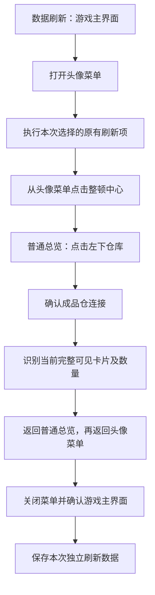

# 当前可见监狱成品刷新

2026-10-29 更新。`player_data_refresh` 保留可选 `prison_products` stage，原有默认四项保持不变。货运不再自动选择该 stage，也不要求监狱成品刷新成功；只有启用汽水或便当时才执行原有 `profile` 恢复资源刷新。不新增 GUI 开关，现有独立读取入口和保存的商品筛选保持不变。

## 参数和观测范围

`prison_product_goods` 可用商品名称或 ID 列表；未指定、`null` 或 `[]` 表示当前可见全部成品。指定几个商品时，仅对匹配商品读取数量；不能确定身份的完整卡片仍记录未知，避免把目标漏读冒充成功。当前未完整显示的所选商品列入 `not_observed`，不填零。

不滚动、不回列表顶部、不点击商品、不领取、不调拨。复用现有仓库页面检测、连接确认、图标模板和数量 OCR；只进行一次稳定视口观测（连续两帧一致），不调用取货流程及完整列表复扫。边缘被截断的卡片记入 `coverage_notes`，不作为已读取商品。

成功表示本次完整可见范围内没有未解决项，不表示仓库完整库存。`scope` 固定 `visible`，`inventory_complete` 固定 `false`；未见商品数量未知。选择商品均不在当前视口时允许空结果，且保留 `not_observed`。

## 保存和货运边界

数据独立保存到 `user-info.json` 的 `prison_products`，包含 `goods`（`goods_id`、`goods`、`quantity`）、`requested_goods`、`not_observed`、`unresolved`、`coverage_notes`、`refreshed_at`、`visible_complete` 和 `returned_to_profile`。部分读取也保存本次明确结果并移除旧成功时间，避免将旧值当成本次刷新。其余用户数据按原规则合并保留。

货运直接启动、工作流货运以及客货运组合均不读取监狱成品。没有开启恢复资源时直接执行货运；开启时只选 `profile`，保持疲劳、汽水、便当的原校验，客货运组合在整个组合前准备。现有 GUI 商品选择仍保存为 `prison_product_goods`，不会加入货运前刷新或正式货运任务参数。普通用户数据页面仍可独立勾选 `prison_products` 阶段并选择商品。

货运仅校验本次启用的恢复资源刷新，不校验监狱成品结果。独立监狱读取的可见范围、数量有效性、保存及返回菜单确认要求保持不变。行情仍在货运内部规划路线前刷新。

## 导航与验证边界

读取 helper 从头像菜单出发并返回该菜单。若整顿中心返回后实际到游戏主界面，须先确认主界面，再打开头像菜单；不将城市建筑界面当作这两个页面。每次点击以新帧确认来源，来源消失后只等待；未知页面不盲点，取消不启动返回点击。

内部任务 `tasks:read_visible_prison_products_pc.yaml:read_visible_prison_products_pc` 可从头像菜单独立调用，输入 `goods` 采用同样的筛选规则，返回观测结果。该内部任务不自行保存用户数据；数据刷新入口负责合并持久化。

头像菜单整顿中心图标来自用户提供的 `codex-clipboard-de68dd08-a424-4918-a5bf-f2ced92699b0.png`，原图和裁剪参数位于 `development/template_sources/prison_product_snapshot/`。根目录运行 `tools/build_prison_product_snapshot_template.py` 可重建模板；不缩放、不生成虚构图标。

初次实施范围为离线代码、截图匹配和模拟服务验证；后续实机记录见下文。

离线记录位于 `.pytest_tmp/prison_visible_20261024/`：核心与既有取货回归 185 项通过，角色及数据刷新兼容回归 11 项通过；GUI 工作流初跑后修正三项旧的“不刷新”预期，全部失败项与新增筛选用例定向通过，另有 61 项用户数据面板及工作流回归通过。`package_cli check/validate` 通过，doctor 为 0 错误、176 条既有缓存警告。入口模板重建和发布资源选择检查通过，开发原图不进入发布包。

### 2026-10-24 实机数据刷新

用户授权运行现有数据刷新／货运前准备入口。CID `769219955055923200`，调用 `player_data_refresh`，输入直接由 GUI `_recovery_refresh_step({})` 生成：`stages=[prison_products]`、`prison_product_goods=[]`；不执行恢复资源读取和实际货运。

从荒原站游戏主界面打开头像菜单，进入整顿中心、仓库并连接成品仓；稳定读取当前可见涤纶（ID `113`）20，随后返回头像菜单并关闭，截图确认恢复游戏主界面。框架 `SUCCESS`，业务 `completed`，`visible_complete=true`，无未知项，`inventory_complete=false`。GUI 使用的货运前校验函数接受本次结果。

`user-info.json` 实际保存的快照与返回值一致，仅 `prison_products` 和 `metadata` 两个顶层字段变化。输入记录为 7 次导航点击、0 次滚动／拖动、0 次商品点击。运行器已关闭，游戏保留打开。证据在 `.pytest_tmp/prison_products_refresh_live_20261024/`：`acceptance.json`、`input-audit.json`、`result.json`、`prison_products.json`、逐帧截图和 `before.png`／`after.png`。

本次仅验收单视口、单成品、不指定筛选且不开启恢复的真实数据刷新；未启动 GUI 货运队列后续任务，也不外推多商品或恢复资源联读的实机结果。
